<p align="center">
  <picture>
    <source media="(prefers-color-scheme: dark)" srcset="frontend/public/brand/rojgar-ai-logo-on-dark.svg">
    
  </picture>
</p>

<h3 align="center">Share one link. Meet the best applicants first.</h3>

<p align="center">
Hiring for every kind of job in Nepal: shop, hotel, clinic, school, bank, factory, transport, office, IT.
</p>

<p align="center">
  
  
  
  
  
  
</p>

<p align="center">
  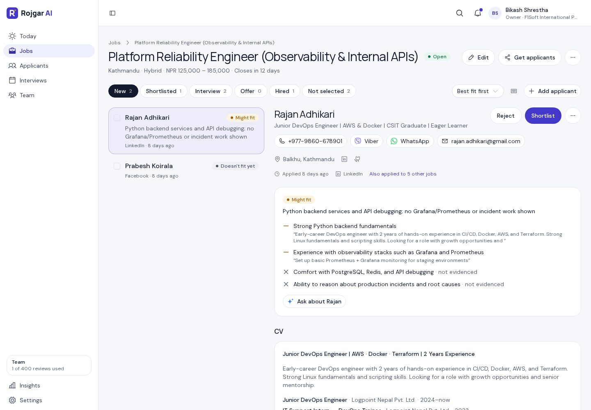
</p>

---

## What it is

A business posts a job and gets **one apply link** to paste into LinkedIn, Facebook, Viber or Merojob, or to print as a QR poster. Applicants apply **without an account** (phone or email, English or नेपाली). They get an email with a private status link, and can sign in with a magic link to see all their applications.

Every CV is read and checked against the job's must-haves, with a one-line reason and a quote from the CV for each one. **AI assists. You decide.** A person makes every hiring decision with one click, and every applicant hears back.

There is no job board for seekers. Rojgar AI is a tool for the people doing the hiring.

## Who it's for

| Role | What they do |
|---|---|
| **Business team** (Owner, Manager, Interviewer) | Post jobs, review applicants, decide, schedule interviews, manage the team and business |
| **Applicant** | Applies from a shared link with no account, follows their status, can sign in with a magic link. Never pays |
| **Platform admin** | Approves new businesses, handles reported jobs, records payments |

## How it works

```text
Business posts a job  ─►  one apply link (LinkedIn · Facebook · Viber · Merojob · QR poster)
                                 │
                                 ▼
             Applicant applies (no account, phone or email, CV if the job needs one)
                                 │
          AI reviews each application soon after it arrives
                 fit: strong · possible · weak, plus a one-line reason
                                 │
           The team sees applicants best-first and decides in one click
      New → Shortlisted → Interview → Offer → Hired   (or Not selected / Withdrawn)
                                 │
                     every applicant hears back by email
```

A person shortlists, rejects, invites and hires. Each decision waits through a short undo window before its email goes out, so nothing is sent by accident.

## Features

- **One apply link per job.** Share it anywhere. Also a printable QR poster, and personal "Suggest someone you know" links that count their own applications.
- **Applying without an account.** Phone or email, Nepali or English. A CV can be a PDF or a photo of a paper CV.
- **CV required, per job.** On by default for office, IT, bank, health, education and NGO jobs; off for driving, hotel, shop, factory and construction jobs, where many good people have no CV. Without a CV, the job can ask up to 5 questions instead of 3.
- **AI that reads every application.** A review with quotes as proof, Ask AI about any applicant, a job-writing helper and search by meaning. See [How AI is used](#how-ai-is-used).
- **Verified businesses.** Sign up as a person, create a business, wait for approval. Only approved businesses' jobs are public.
- **Teams and roles.** Owner, Manager, Interviewer. Invite-only, with an audit trail.
- **Interviews.** Applicants pick a time from a signed booking link. Video links use Jitsi Meet (no account needed). `.ics` invites in Nepal time, reschedule and cancel, reminders 24 hours and 1 hour before, and "How did it go?" notes.
- **Everything in one place.** Today page, a job page with a side panel for each applicant, insights, notifications and an activity feed.
- **English and नेपाली** across the public pages and the applicant side, with Noto Sans Devanagari for Nepali text.

## A quick tour

The job page above is where most of the work happens: applicants best fit first, and one click to see why and decide.

### For applicants

<table>
  <tr>
    <td width="50%" valign="top">
      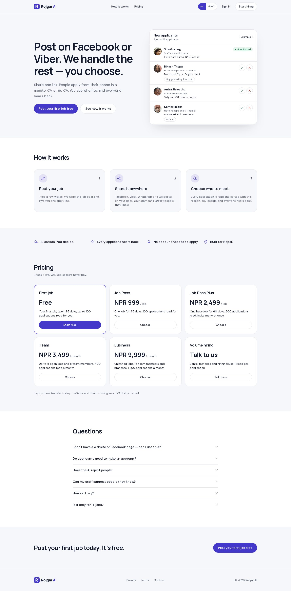<br>
      <b>Landing page</b><br>
      <sub>What it does, how it works and the prices, for a small business owner.</sub>
    </td>
    <td width="50%" valign="top">
      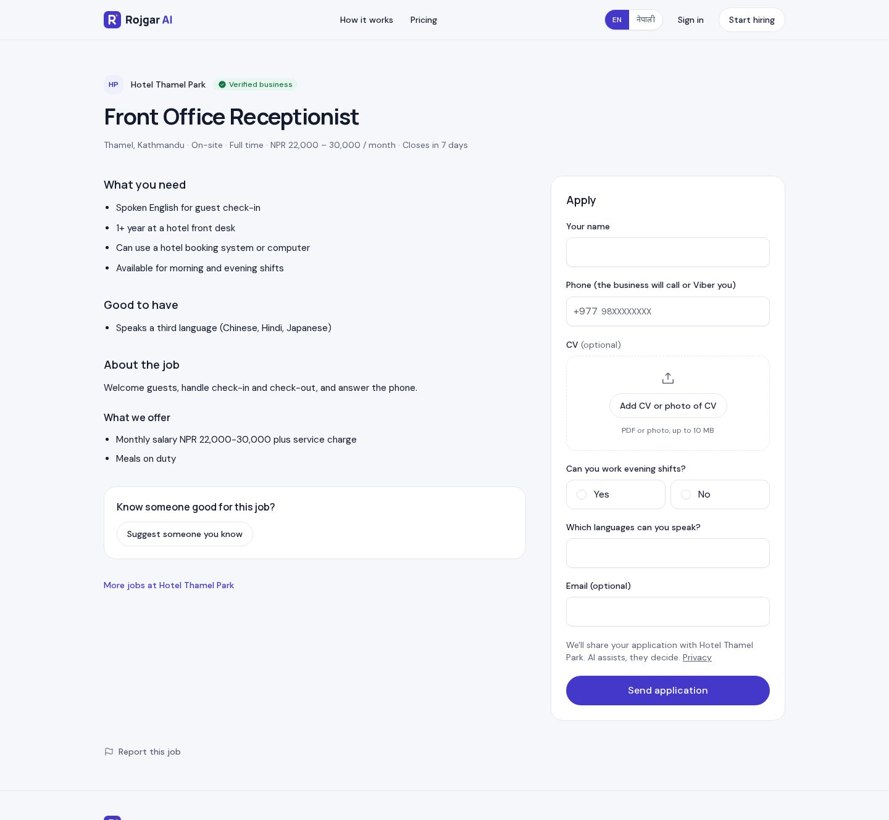<br>
      <b>A job's apply page</b><br>
      <sub>One link for LinkedIn, Facebook, Viber or Merojob. Name, phone, CV if the job needs one, and the job's questions. No account.</sub>
    </td>
  </tr>
  <tr>
    <td width="50%" valign="top">
      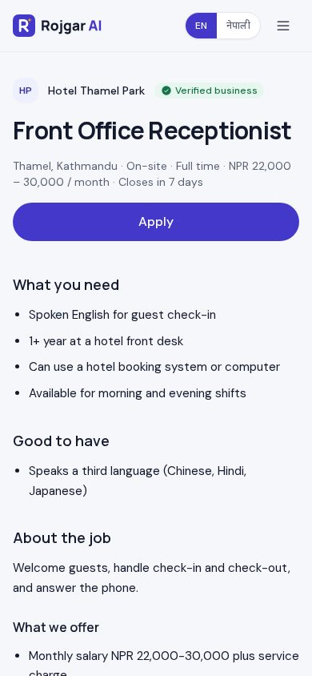<br>
      <b>On a phone</b><br>
      <sub>Built phone-first, in English or Nepali.</sub>
    </td>
    <td width="50%" valign="top">
      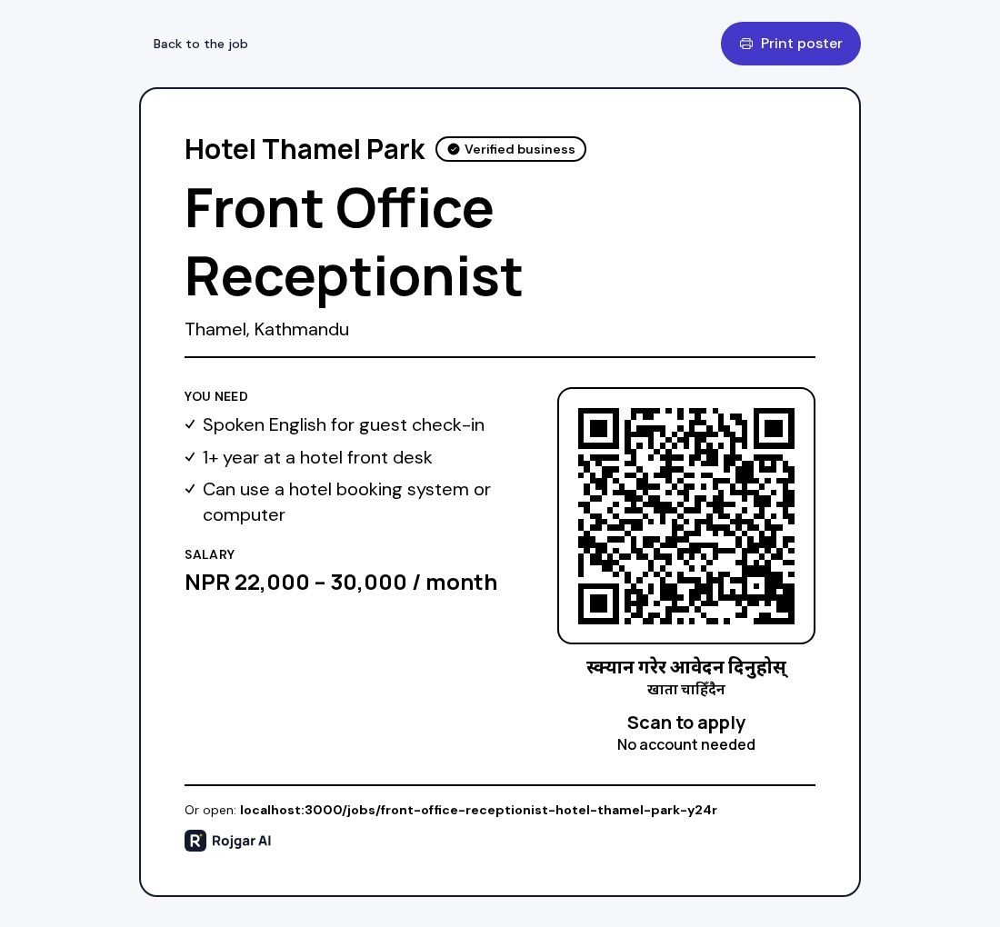<br>
      <b>QR poster</b><br>
      <sub>Print it for the shop door or a notice board; people scan to apply.</sub>
    </td>
  </tr>
  <tr>
    <td width="50%" valign="top">
      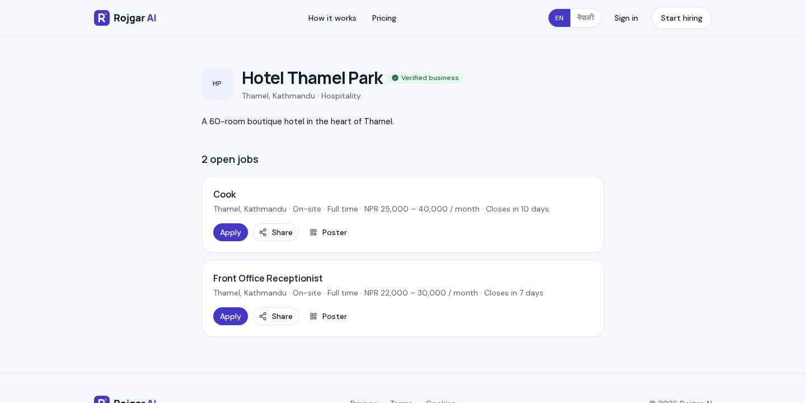<br>
      <b>Careers page</b><br>
      <sub>Every open job of one business on one page.</sub>
    </td>
    <td width="50%" valign="top">
      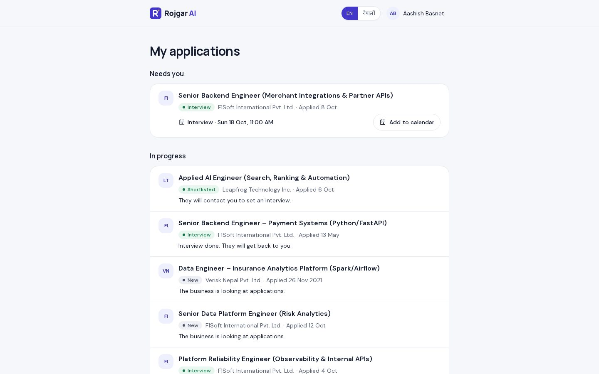<br>
      <b>My applications</b><br>
      <sub>Applicants sign in with a magic link and see where each application stands.</sub>
    </td>
  </tr>
</table>

### For the hiring team

<table>
  <tr>
    <td width="50%" valign="top">
      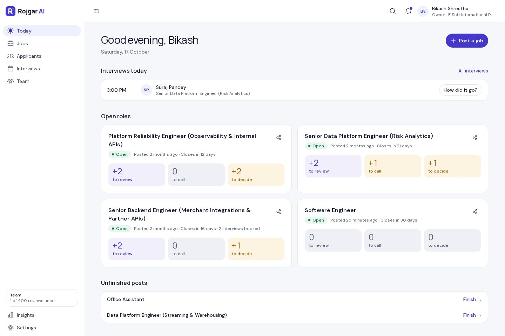<br>
      <b>Today</b><br>
      <sub>What needs you now: interviews today, and per job who is waiting to be reviewed, called or decided.</sub>
    </td>
    <td width="50%" valign="top">
      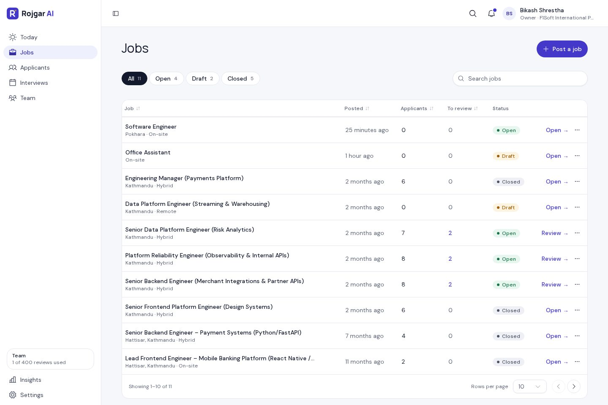<br>
      <b>Jobs</b><br>
      <sub>Every job with its applicants and how many are waiting.</sub>
    </td>
  </tr>
  <tr>
    <td width="50%" valign="top">
      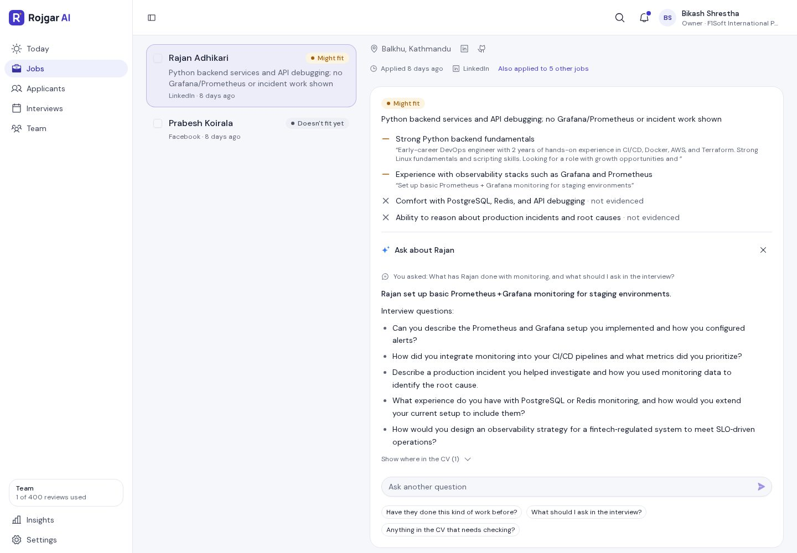<br>
      <b>Ask AI about an applicant</b><br>
      <sub>Answers come only from the applicant's data, with quotes, plus interview questions.</sub>
    </td>
    <td width="50%" valign="top">
      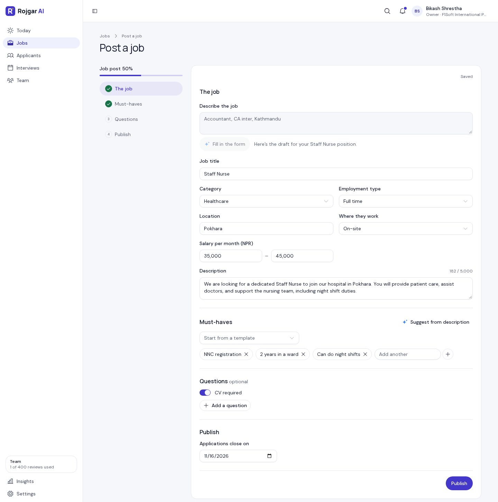<br>
      <b>Post a job with AI</b><br>
      <sub>One sentence in, a full job post out: title, category, salary, description, must-haves. Edit anything.</sub>
    </td>
  </tr>
  <tr>
    <td width="50%" valign="top">
      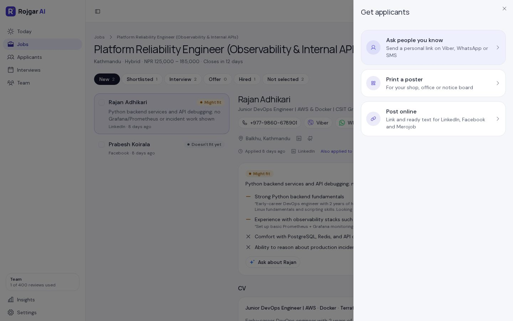<br>
      <b>Get applicants</b><br>
      <sub>Ask people you know, print a poster, or post online.</sub>
    </td>
    <td width="50%" valign="top">
      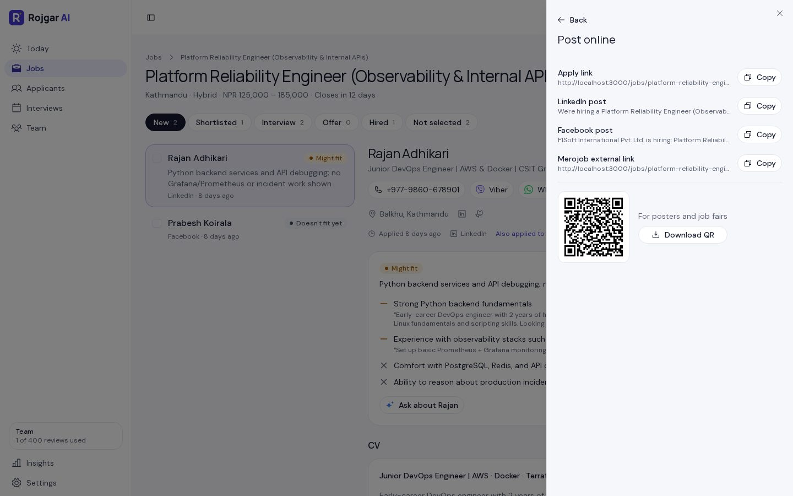<br>
      <b>Post online</b><br>
      <sub>The apply link and ready text for LinkedIn, Facebook and Merojob, plus a QR code.</sub>
    </td>
  </tr>
  <tr>
    <td width="50%" valign="top">
      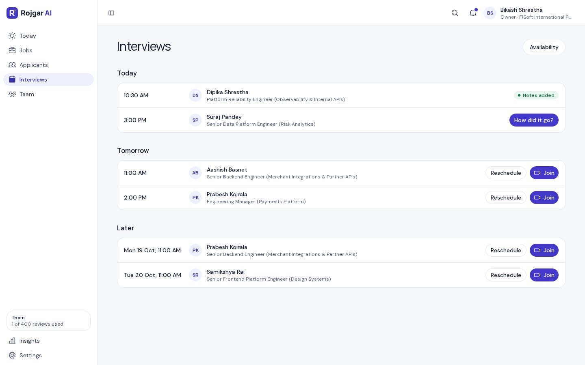<br>
      <b>Interviews</b><br>
      <sub>Applicants pick a time from a link; video by Jitsi; “How did it go?” notes afterwards.</sub>
    </td>
    <td width="50%" valign="top">
      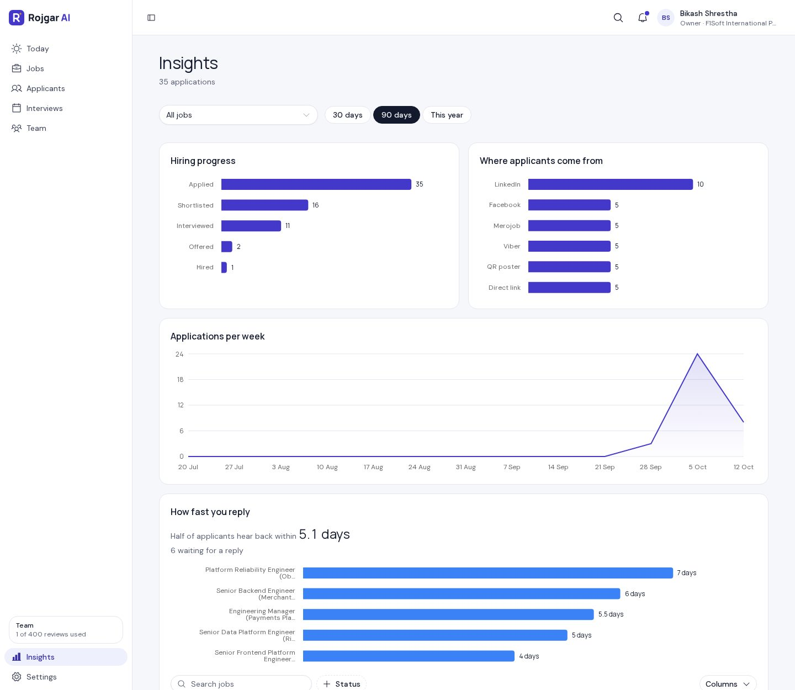<br>
      <b>Insights</b><br>
      <sub>Hiring progress, where applicants come from, and how fast everyone hears back.</sub>
    </td>
  </tr>
  <tr>
    <td width="50%" valign="top">
      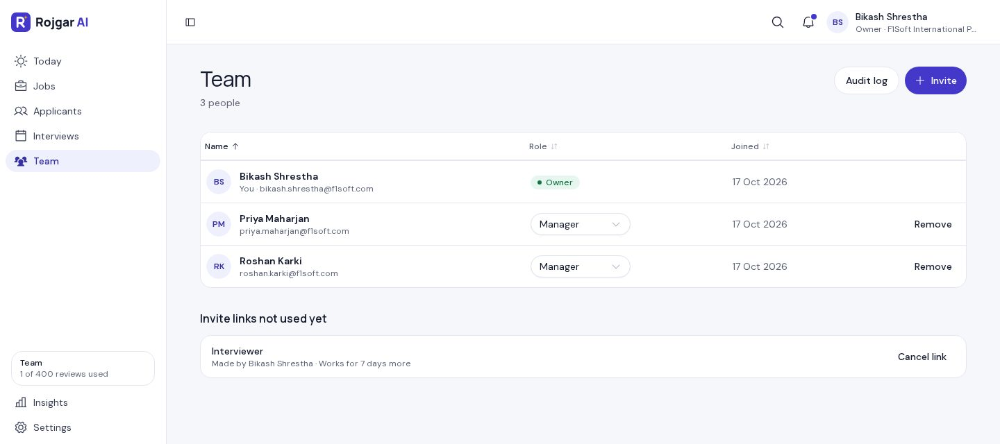<br>
      <b>Team</b><br>
      <sub>Owner, Manager and Interviewer roles, invite links and an audit log.</sub>
    </td>
    <td width="50%" valign="top">
      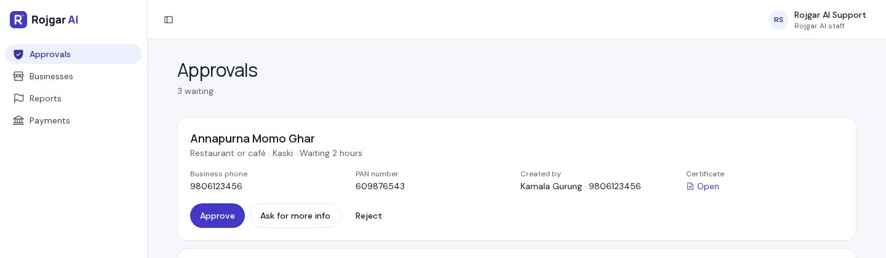<br>
      <b>Platform admin</b><br>
      <sub>New businesses are checked before their jobs go public.</sub>
    </td>
  </tr>
</table>

## How AI is used

**AI assists. You decide.** AI reads every application, suggests and drafts. It never decides alone and never changes data: every hiring decision is a person's click. Every AI answer comes back in a fixed structure and is checked in code before anyone sees it.

### At a glance

| Feature | Where you see it | What AI does |
|---|---|---|
| **Application review** | Fit pill and one-line reason on every applicant | Checks each must-have (met, partly, missing) and quotes the CV as proof |
| **Ask AI** | Applicant panel | Answers questions about one applicant, only from their data, with quotes |
| **Job-writing helper** | New job | Turns a sentence like "need a cook in Pokhara" into a full job post; looks up typical pay when asked |
| **Suggested must-haves** | Job builder → *Suggest from description* | Proposes must-haves, nice-to-haves and apply-form questions |
| **Applicant search** | Applicants page search box | Finds applicants by meaning as well as keywords ("worked on payments") |
| **CV reading** *(optional)* | After someone applies with a PDF | Turns the CV into jobs, education and skills |

### Reviewing an application

Each application is reviewed shortly after it arrives, one at a time, so nobody waits for a closing date.

```text
application ─► knockout answers ─► shorten long CVs ─► safety check ─► quick review ─► full review
               (rules, no AI)      (local model)        (injection)     (small model)   (only when needed)
                                                                              │
                                     fit + reason, worked out in code ◄───────┘
```

1. **Knockout answers.** A wrong answer to a must-answer question ("Do you have a licence?" → No) is decided by rules, with no AI call.
2. **Blind text.** The reviewer never sees names, contact details, photos, links or school names.
3. **Shorter input.** A long CV is cut to the passages that best match the job's criteria, about 1,000 tokens, chosen by a local model. Answers to the job's questions are always kept.
4. **Safety check.** The text is checked for hidden instructions aimed at the AI. If found, the application goes to a person instead of the AI.
5. **Quick review, then full review.** A small model checks every must-have first. The larger model reviews again only if the person looks like a possible fit.
6. **Checked in code.** Every quote must appear word for word in the CV, or that check counts as missing. The fit (strong, possible, weak) is calculated from the checks, not written by the AI. Applicants never see AI output.

### Ask AI about an applicant

Ask anything about one applicant: "Has she used React in production?", "What should I ask in the interview?". The answer comes only from that applicant's CV, form answers, review, interview notes and activity. Every quote is checked against those words, and an answer without support becomes "Not in their CV or notes." Ask it to shortlist or reject someone and it points you to the button; it can't do it itself.

Each team member's conversation about an applicant is remembered (the last few questions) in Rojgar AI's own database, so it's deleted along with the applicant's data.

### Writing a job post

The job-writing helper is an agent with one tool, a salary search. When you ask what to pay, it looks up typical pay for the job title and town (nothing else is sent) and cites its sources. A salary number in the draft must come from you or from a cited source, or it's removed. It never adds requirements about gender, age, caste, religion, marital status or looks.

### Models

| Purpose | Model | Runs on |
|---|---|---|
| Review, Ask AI, job helper, suggestions, safety check | `gpt-oss-120b`; `gpt-oss-20b` for the quick review | Groq |
| Fallback when Groq is busy or down | `gemini-2.5-flash` (set `GEMINI_API_KEY`) | Google |
| Search, CV shortening | `multilingual-e5-small` (English, Nepali, romanized Nepali) and BM25 | Local CPU, free |
| Ordering applicants with nearly equal reviews | scikit-learn model, never decides fit | Local CPU, free |
| Salary lookups for the job helper | Tavily web search | Tavily |
| Reading PDF CVs *(optional)* | LlamaCloud extraction (set `LLAMA_CLOUD_API_KEY`) | LlamaCloud |

Every model call goes through one place, `backend/app/infrastructures/ai/llm.py`, built on LangChain agents with structured output. The tests use a scripted model, so no test calls a real provider.

### Staying within free limits

Rojgar AI runs on free tiers, so it counts every model's requests per minute, requests per day and tokens per minute (in Redis, shared by all servers).

- **Before a call:** if a call would go over a model's limit, it goes straight to the other provider (Groq to Gemini).
- **After a "too many requests" error:** that model is skipped for exactly as long as the provider asked, or until its daily reset.
- **When everything is busy:** Ask AI and the job helper say so and ask you to try again in a moment. Reviews wait and continue later; they never fail or use up retries because of limits.
- **Smaller requests:** long CVs are shortened and answer sizes are capped, because Groq counts both against its per-minute limit.

### Safety

- **Hidden instructions.** Text is cleaned of invisible characters, scanned for known injection phrases, and checked by an AI classifier. The text it checks is wrapped in a random tag, so it can't fake the end of its own input. Reviews treat an unavailable check as unsafe and hand the application to a person; even an attack that slips through can't change a decision, because the AI's answers are only data checked in code.
- **Fair criteria.** Must-haves and questions are checked against Nepal's Labour Act 2074, section 6 (gender, caste or ethnicity, religion, marital status, age and more). Saving is never blocked; the team is asked to reword.
- **Private data.** Emails, links and phone numbers are removed before a model reads an application. CVs and business documents are private files, opened only through short-lived signed links.
- **People decide.** No AI feature can move an applicant, send a message or change a job. Decisions are made by a person, wait through an undo window and are kept in the audit log.

### What isn't AI

Filling in your name and email from a CV, knockout questions, the unfair-criteria warning, the fit pill's final value, quote checking and every stage change are plain rules in code: predictable, instant and free.

## Architecture

A monorepo with a Python API and a Next.js app. The frontend talks to the backend only over HTTP (RTK Query, plus server-sent events for AI answers). The backend owns the database, cache, vector store, file storage and every AI call.

```
┌──────────────────────────────┐        ┌──────────────────────────────────────────────┐
│  frontend/  (Next.js 16)     │  HTTP  │  backend/  (FastAPI, async)                  │
│  App Router · React 19       │ ─────► │  modules/*  router → service → models        │
│  RTK Query · Tailwind v4     │  SSE   │  SQLAlchemy 2 async · Pydantic v2 · Alembic  │
│  shadcn/ui · Phosphor icons  │        └───────┬───────────────┬───────────────┬──────┘
└──────────────────────────────┘                │               │               │
                                           PostgreSQL         Redis          Qdrant
                                        (source of truth) (cache, locks) (CV search)
                                                │
                         SMTP email · Cloudinary files · Sparrow SMS (off by default)
                                                │
              Groq · Gemini (fallback) · Tavily · LlamaCloud (optional)
              local: multilingual-e5-small embeddings (fastembed) · scikit-learn
```

Backend modules (`backend/app/modules/`): `activity`, `admin`, `applications`, `assistant`, `audit`, `auth`, `companies`, `dashboards`, `entitlements`, `interviews`, `jobs`, `notifications`, `public`, `recruiter_preferences`, `resumes`, `review`.

Background work runs inside the API process (started in `main.py`):
- An hourly job closes jobs past their closing date.
- A loop reviews applications that were waiting for review credits.
- A loop sends interview reminders; a database lock makes sure only one worker sends them.
- A loop retries failed search-index updates.
- On startup, the API finishes reviews and emails that were interrupted.

## Tech stack

**Frontend:** Next.js 16 (App Router, Turbopack), React 19, TypeScript, Redux Toolkit and RTK Query, Tailwind CSS v4, shadcn/ui (Radix), TanStack Table, Recharts, Sonner toasts, Phosphor icons, react-hook-form and Zod, Playwright and axe for end-to-end and accessibility tests.

**Backend:** Python 3.12, FastAPI, SQLAlchemy 2 (async) with asyncpg, Pydantic v2, Alembic, PostgreSQL, Redis, Qdrant, APScheduler, Argon2, PyJWT, aiosmtplib, Cloudinary, pypdf, `uv` for dependencies, `pytest`.

**AI:** LangChain agents on Groq, with Gemini as fallback; local `multilingual-e5-small` and BM25 (fastembed); scikit-learn. See [How AI is used](#how-ai-is-used).

## Repository layout

```
.
├── backend/                 FastAPI app
│   ├── app/
│   │   ├── core/            config, constants, database, security, rate limits, schedulers
│   │   ├── infrastructures/ ai, guardrails, qdrant, redis, storage, email, sms, search
│   │   ├── modules/         one folder per area (router · service · models · schemas)
│   │   └── shared/          enums, helpers
│   ├── alembic/versions/    database migrations
│   ├── scripts/             make_platform_admin, seed_demo_refresh, seed_e2e, reindex_embeddings
│   ├── simulation/          fairness, red-team and load test harness
│   ├── tests/               pytest suite
│   ├── seed_data.py         local demo data
│   └── main.py              app, background tasks, routers
├── frontend/
│   ├── src/app/             routes: public site, (auth), (legal), recruiter, me, admin
│   ├── src/components/      ui/ (shadcn), app/ (product), screens/, public/, me/, today/
│   ├── src/store/           RTK Query services and slices
│   ├── src/lib/             API clients, i18n, brand, helpers
│   ├── public/brand/        logo SVGs
│   ├── e2e/                 Playwright specs
│   └── eslint.config.mjs    design-system rules
├── docs/                    RECRUITER_FLOW.md · DESIGN_SYSTEM.md
├── AGENTS.md                rules for anyone (person or AI) changing the code
├── DESIGN.md                design language: tokens, components, voice
├── PRICING.md               plans and how limits work
├── HANDOVER.md              current status and what's left
└── docker-compose.yml       local Postgres, Qdrant and Redis
```

## Getting started

You need **Python 3.12** with [uv](https://docs.astral.sh/uv/), **Node.js** with npm, and Docker (or Postgres, Redis and Qdrant installed yourself).

Everything runs **locally**. Never point a local `.env` at production databases.

### 1. Local services

```bash
docker compose up -d          # Postgres :5433 · Qdrant :6335 · Redis :6380
```

No Docker? Install Postgres 16, Redis and the Qdrant binary and use the same ports.

### 2. Backend

```bash
cd backend
cp .env.example .env          # fill in local DB, Qdrant, Redis and your API keys
uv sync
uv run alembic upgrade head
uv run fastapi dev main.py    # http://localhost:8000  (API docs at /docs in dev)
```

Point `.env` at the local services: `DB_HOST=localhost`, `DB_PORT=5433`, `QDRANT_URL=http://localhost:6335`, `REDIS_URL=redis://localhost:6380/0`, and set `ENVIRONMENT=dev`. Uploaded files are saved on local disk unless you set `STORAGE_BACKEND=cloudinary`. The embedding model downloads once from Hugging Face on first use, into `MODEL_CACHE_DIR`.

### 3. Frontend

```bash
cd frontend
cp .env.example .env.local    # NEXT_PUBLIC_BACKEND_URL=http://localhost:8000
npm install
npm run dev                   # http://localhost:3000
```

### 4. Demo data and logins

```bash
cd backend
uv run python seed_data.py
uv run python scripts/seed_demo_refresh.py   # if the Today page looks empty on a later day
```

Both scripts refuse to run against anything but a local database. Every seeded login uses the password `Password@123`:

| Role | Email |
|---|---|
| Business member | `priya.maharjan@f1soft.com` |
| Business owner | `bikash.shrestha@f1soft.com` |
| Applicant | `aashish.basnet@gmail.com` |
| Platform admin | `admin@rojgarai.app` |

## Commands

Run these before every push. CI runs the same checks.

**Backend** (from `backend/`):

```bash
REDIS_ENABLED=true uv run pytest -p no:cacheprovider -o addopts="" -q   # tests
uvx ruff@0.14.10 check                                                  # lint
uvx ruff@0.14.10 format                                                 # format
uv run alembic heads                                                    # must print one head
```

**Frontend** (from `frontend/`):

```bash
npm run type-check            # tsc --noEmit
npm run lint                  # eslint src
npm run format:check          # prettier
npm run build                 # next build
npm run e2e                   # Playwright (starts the test stack, backend and frontend)
npm run fix-all               # types, then lint --fix, then prettier
```

**Design file:**

```bash
npx @google/design.md@0.4.0 lint DESIGN.md
```

## Design and branding

Calm, plain-spoken and phone-first. Every screen answers *"what needs me now?"*, with the next action one click away.

- **Colours:** indigo `#4338CA` on cool neutrals, `success` / `warning` / `danger` / `neutral` tones, and an AI gradient (indigo → blue → cyan → teal) that appears only while AI is working. Components use tokens from `frontend/src/app/globals.css`, never hex values.
- **Type:** Manrope for headings and numbers, DM Sans for everything else, Noto Sans Devanagari for नेपाली.
- **Logo:** `frontend/public/brand/` has `rojgar-ai-logo.svg` (light), `rojgar-ai-logo-on-dark.svg`, `rojgar-ai-logo-mono.svg` and `rojgar-ai-mark.svg`. In the app: `components/app/Logo.tsx` (`variant="full" | "mark"`).
- **Words:** Business, Team, Job, Applicant, "Suggest someone you know". Stages: New · Shortlisted · Interview · Offer · Hired · Not selected. The UI never says "candidate", "recruiter", "pipeline", "AI screening" or "evaluation".

ESLint (`frontend/eslint.config.mjs`) enforces the design system: no raw `<button>`, `<input>`, `<select>`, `<textarea>`, `<table>` or `<dialog>` outside `components/ui`, icons only through `components/icons.ts`, and no SCSS.

## Pricing

Applying is always free; applicants never pay. Businesses pay only for the AI that reads applications, and the first job is free. See [PRICING.md](PRICING.md).

## Documentation

| File | What's in it |
|---|---|
| [AGENTS.md](AGENTS.md) | Rules for changing the code: product principles, words, design system, backend rules, checks |
| [DESIGN.md](DESIGN.md) | Design language: tokens, type, components, voice |
| [docs/RECRUITER_FLOW.md](docs/RECRUITER_FLOW.md) | The hiring flow screen by screen, and the data model |
| [docs/DESIGN_SYSTEM.md](docs/DESIGN_SYSTEM.md) | Component library reference |
| [PRICING.md](PRICING.md) | Plans, review limits, payments |
| [HANDOVER.md](HANDOVER.md) | Current status, how to deploy, what's left |

## License

See [LICENSE](LICENSE).
